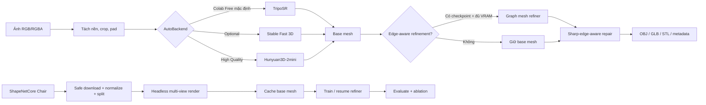

# Single-Image to 3D Reconstruction with Edge-Aware Geometry Refinement

Khung dự án Colab-first để nghiên cứu chuyển một ảnh RGB thành mesh 3D với
ShapeNetCore làm nguồn ground truth chính. Hướng phát triển ưu tiên độ chính
xác hình học và bảo toàn cạnh sắc, với mục tiêu xuất OBJ, GLB và STL.

Ảnh đơn không chứa đủ thông tin để khôi phục tuyệt đối hình học bị che khuất;
kết quả ở các giai đoạn sau sẽ là ước lượng có học từ prior, không phải phép
đo đầy đủ vật thể.

## Phạm vi hiện tại

Repository hiện có pipeline dữ liệu, renderer headless, pretrained base mesh,
edge-aware refinement/training/evaluation, hậu xử lý mesh và giao diện Gradio.
Production inference không dùng mesh giả; backend test chỉ tồn tại trong pytest.

## Kiến trúc và luồng xử lý



Refiner giữ topology ở phiên bản hiện tại, chiếu feature ảnh lên vertex rồi dự
đoán displacement có giới hạn. Cạnh có góc dihedral lớn được đánh dấu sharp để
giảm message passing, loại khỏi Laplacian smoothing và được bảo vệ khi decimate.

## Yêu cầu hệ thống

- Python 3.10–3.12; luồng đã audit dùng Python 3.12.10.
- Quick synthetic: CPU, RAM khoảng 1 GB trống và dưới 100 MB disk là đủ theo số
  đo hiện tại; không cần HF_TOKEN hoặc CUDA.
- Colab Free production: chọn GPU, batch size 1, mixed precision, TripoSR
  geometry-only. TripoSR upstream nêu mức khoảng 6 GB VRAM cho cấu hình mặc định.
- ShapeNetCore thật: quyền gated và secret `HF_TOKEN` loại Read.
- **Optional:** texture, Stable Fast 3D và `pymeshlab`.
- **High Quality:** Hunyuan3D-2mini và cấu hình resolution/sample lớn; không được
  xem là đảm bảo chạy trên mọi GPU Colab miễn phí.

## Bắt đầu nhanh trên Google Colab

1. Clone repository hoặc mở notebook từ repository đã clone.
2. Chọn **Runtime → Change runtime type → GPU**.
3. Trong Colab Secrets, thêm `HF_TOKEN` loại Read; bật quyền notebook truy cập.
4. Chạy lần lượt **Run all**:
   `01_setup_and_dataset.ipynb` → `02_render_shapenet.ipynb` →
   `03_train_refiner.ipynb` → `04_evaluate.ipynb` →
   `05_inference_gradio.ipynb`.
5. Mặc định cả chuỗi dùng `quick_test` synthetic và hoàn tất không cần dataset
   thật. Script/notebook có manifest/checkpoint nên chạy lại sẽ resume.
6. Khi đã được duyệt ShapeNetCore, dùng `configs/chair_colab.yaml` cho pipeline
   production; không tải toàn bộ dataset, chỉ tải ZIP Chair `03001627.zip`.

Không dán token vào cell, YAML hoặc lệnh shell. Pipeline đọc `HF_TOKEN` từ biến
môi trường trước, sau đó từ `google.colab.userdata`.

## Cài đặt ban đầu

Yêu cầu Python 3.10 trở lên. Trên Google Colab miễn phí hoặc máy local:

```bash
git clone <repository-url>
cd image-to-3d-shapenet
python -m pip install -r requirements-colab.txt
python -m pip install -e .
```

Để chạy test phát triển:

```bash
python -m pip install -r requirements-dev.txt
python -m pytest
```

Luồng mặc định không yêu cầu CUDA extension. `quick_test.yaml` dùng batch size
1 và chỉ tạo ba mesh synthetic nhỏ, do đó chạy được khi không có dataset thật
hoặc GPU.

## Quick test không cần ShapeNetCore

Lệnh sau tạo cube, rectangular box và một mesh có component lỗi; sau đó kiểm
tra, chuẩn hóa, ghi transform nghịch đảo, loại mesh lỗi và tạo split JSON:

```bash
python scripts/prepare_dataset.py --config configs/quick_test.yaml
```

Chạy lại cùng lệnh sẽ bỏ qua các mesh đã chuẩn hóa đầy đủ. Đây là lệnh Run all
nhẹ dành cho Colab Free; dữ liệu synthetic chỉ phục vụ kiểm thử pipeline, không
được dùng làm kết quả production.

## Truy cập ShapeNetCore thật

ShapeNetCore là gated dataset. Trước khi chạy:

1. Đăng nhập [Hugging Face](https://huggingface.co/login).
2. Mở [ShapeNet/ShapeNetCore](https://huggingface.co/datasets/ShapeNet/ShapeNetCore).
3. Điền họ tên, giảng viên và trường, chấp nhận điều khoản và chờ cấp quyền nếu cần.
4. Tạo token loại **Read** tại [Access Tokens](https://huggingface.co/settings/tokens).
5. Local: đặt biến môi trường `HF_TOKEN`. Colab: thêm secret tên `HF_TOKEN`.

Không đặt giá trị token vào YAML, notebook, lệnh commit hoặc source code.
Pipeline đọc environment trước, sau đó mới đọc `google.colab.userdata`.

Chạy category Chair:

```bash
python scripts/prepare_dataset.py --config configs/chair_colab.yaml
```

Pipeline gọi `huggingface_hub.hf_hub_download` với `repo_type="dataset"` và
`filename="03001627.zip"`; không dùng `snapshot_download` và không tải toàn bộ
repository. Hub cache hỗ trợ tiếp tục download, còn extraction dùng file tạm,
skip file đã đủ kích thước và marker hoàn tất.

Một cell Colab sau khi đã clone repository và thêm secret:

```python
!python -m pip install -q -r requirements-colab.txt
!python -m pip install -q -e .
!python scripts/prepare_dataset.py --config configs/chair_colab.yaml
```

## Giới hạn tài nguyên và đầu ra

Các khóa trong `dataset` giới hạn `max_meshes`, `max_train_meshes`,
`max_val_meshes`, `max_test_meshes`, kích thước archive/extraction, số ZIP
member, dung lượng trống tối thiểu và kích thước từng OBJ. Mesh được xử lý tuần
tự để tránh giữ nhiều model trong RAM.

Đầu ra chính:

- `data/processed/03001627/<model_id>/model_normalized.obj`;
- `transform.json` chứa ma trận thuận và nghịch;
- `outputs/.../splits.json` với tỉ lệ 70/15/15, seed 42;
- `invalid_meshes.json` và `dataset_preparation_report.json`.

## Render dữ liệu image-to-3D

Sau khi chuẩn bị mesh, chạy:

```bash
python scripts/render_dataset.py --config configs/chair_colab.yaml
```

Quick test Colab Free tự chuẩn bị synthetic data nếu cần và chỉ render 1
mesh/1 view ở 128×128:

```bash
python scripts/render_dataset.py --config configs/quick_test.yaml
```

Notebook Run all: `notebooks/02_render_shapenet.ipynb`. Notebook cài dependency,
chuẩn bị synthetic mesh, render và hiển thị RGB, mask, depth, normal từ trên
xuống dưới; `MAX_MESHES` cho phép chọn 1–5 mesh.

### Renderer và fallback

`render.backend: auto` ưu tiên Pyrender `OffscreenRenderer`. Trên Linux/Colab,
backend đặt EGL trước khi import OpenGL để chạy không cần display. Nếu Pyrender,
EGL hoặc OpenGL context không tương thích, `auto` chuyển sang rasterizer NumPy
headless. Fallback rasterize mesh thật bằng z-buffer CPU, không mock output và
không cần CUDA extension, nhưng chậm hơn trên mesh nhiều polygon.

PyTorch3D và nvdiffrast không nằm trong luồng mặc định vì thường phụ thuộc chặt
vào phiên bản PyTorch/CUDA hoặc CUDA extension. Blender cũng không bắt buộc.
Có thể chọn rõ backend:

```bash
python scripts/render_dataset.py --config configs/quick_test.yaml --backend pyrender
python scripts/render_dataset.py --config configs/quick_test.yaml --backend software
```

Config mặc định dùng 256×256, Chair có 8 view quanh 360 độ; quick test dùng
128×128. Có thể đặt `runtime.image_size: 512` nếu tài nguyên cho phép. Camera
nhìn vào tâm mesh, khoảng cách theo bounding box và lưu intrinsics, extrinsics,
projection, pose, near/far, azimuth và elevation để tái tạo camera.

Mỗi sample chứa:

- `rgb.png`, `rgba.png`, `mask.png`;
- `depth.npy` float32 theo khoảng cách camera;
- `normal.png` và trường `normal_space` trong metadata;
- `camera.json`, `sample.json`;
- model/category ID, split và đường dẫn ground-truth mesh.

`manifest.json` được ghi atomically sau mỗi view. Sample đủ file và có trạng
thái `complete` sẽ được bỏ qua; sample thiếu bất kỳ file nào sẽ được render lại
đúng cùng sample ID. Nền train có thể random deterministic bằng
`random_background_train`; validation/test luôn dùng nền cố định.

## Kiểm tra config

```python
from image_to_3d_shapenet import load_config

config = load_config("configs/quick_test.yaml")
print(config.runtime.batch_size)
```

Xem [PROJECT_STATUS.md](PROJECT_STATUS.md) để biết trạng thái đã kiểm chứng và
các phần còn lại.

## Pretrained base-mesh inference

Luồng mặc định là geometry-only, batch 1 và chỉ load một model lên GPU tại một
thời điểm. `auto` ưu tiên TripoSR trên Colab Free; Stable Fast 3D chỉ được chọn
khi source/dependency, quyền model gated và weights sẵn sàng; Hunyuan3D-2mini-
Turbo chỉ được xét trong `high_quality`. Nếu load hoặc generate lỗi, model hiện
tại được unload, chạy `gc.collect()`/`torch.cuda.empty_cache()` rồi mới thử
backend kế tiếp.

Notebook Run all có một setup cell và smoke test model thật:

```text
notebooks/03_pretrained_backends.ipynb
```

TripoSR upstream không phát hành package `tsr` độc lập trên PyPI; setup cell clone
official source vào `.cache/backends/TripoSR` và cài dependency của upstream.
Dependency này có `torchmcubes`, nên notebook chỉ cài khi có CUDA. Phần dataset,
renderer và toàn bộ unit test vẫn chạy nếu bước backend này không tương thích.
Có thể đặt checkout ở nơi khác bằng `TRIPOSR_SOURCE_DIR`; tương tự,
`SF3D_SOURCE_DIR` và `HUNYUAN3D_SOURCE_DIR` dành cho hai backend nâng cao.

CLI sau đọc PNG/JPG, tách nền, crop theo alpha, pad/center không kéo méo và xuất
`base_mesh.obj`, `base_mesh.glb`, ảnh đã preprocess cùng `metadata.json`:

```bash
python scripts/infer.py --image path/to/image.png --backend auto --output outputs/example
```

Chạy high-quality (chỉ khi đã cài/được cấp quyền Hunyuan):

```bash
python scripts/infer.py --image path/to/image.png --backend auto --high-quality --output outputs/hq
```

Stable Fast 3D và Hunyuan có license/quyền truy cập riêng; người dùng phải tự
đọc, chấp nhận và cung cấp `HF_TOKEN` nếu model gated. Token không được ghi vào
config, notebook, metadata hay log. Tham khảo source chính thức:
[TripoSR](https://github.com/VAST-AI-Research/TripoSR),
[Stable Fast 3D](https://github.com/Stability-AI/stable-fast-3d) và
[Hunyuan3D-2](https://github.com/Tencent-Hunyuan/Hunyuan3D-2).

Smoke test pretrained trong pytest là opt-in:

```bash
RUN_PRETRAINED_SMOKE=1 python -m pytest tests/test_pretrained_smoke.py -q
```

Test này skip nếu không có CUDA. Skip không được tính là bằng chứng backend model
thật đã chạy; xem trạng thái xác minh cụ thể trong `PROJECT_STATUS.md`.

## Edge-aware mesh refiner

Refiner phiên bản đầu giữ nguyên topology và dự đoán displacement cho từng
vertex. Luồng mặc định chỉ dùng toán tử PyTorch chuẩn, batch size 1, không cần
PyTorch3D hoặc CUDA extension tự biên dịch. `configs/quick_test.yaml` dùng encoder
CNN nhỏ, 2 graph blocks, hidden dimension 32 và chạy forward/backward trên CPU.
`chair_colab.yaml` dùng ResNet18 pretrained/frozen; nếu `torchvision` không tương
thích thì chuyển sang encoder nhẹ và phát warning.

Đặc trưng node gồm vị trí, vertex normal, local curvature, dihedral/sharpness,
visibility và feature ảnh nhiều scale được chiếu bằng camera intrinsics cùng
world-to-camera extrinsics. Camera metadata từ renderer hiện tại dùng convention
OpenGL (`-Z` forward); có thể chọn `opencv` trong config. Visibility thực từ
depth/z-buffer có thể truyền trực tiếp vào model; nếu không có, model dùng kiểm
tra camera frustum.

Message passing giảm trọng số qua cạnh sắc. Displacement được giới hạn bằng
`tanh * max_displacement`. Loss tổng gồm Chamfer, normal, silhouette, sharp-edge,
Laplacian, displacement và boundary. Edge loss sample riêng trên cạnh sắc với
trọng số cao hơn và bảo toàn dihedral; Laplacian bỏ các edge sắc. Backend
Chamfer `auto` dùng PyTorch3D nếu import được, nếu không dùng `torch.cdist` thuần
PyTorch; chọn bắt buộc `pytorch3d` sẽ trả thông báo dependency rõ ràng.

Smoke forward/backward và overfit hai bước:

```bash
python scripts/refiner_quick_test.py --config configs/quick_test.yaml
```

Đầu ra debug tại `outputs/quick_test/refiner/` gồm `mesh_before.obj`,
`mesh_after.obj` và `sharp_edges.png`; cạnh sắc màu đỏ, cạnh thường màu xanh.
Đây là smoke bằng cube synthetic để xác minh pipeline, không phải kết quả mô hình
đã huấn luyện trên ShapeNetCore.

## Training pipeline và base-mesh cache

Training đọc trực tiếp render manifest và nạp RGB, mask, depth, normal, camera,
ground-truth mesh, cached base mesh, model ID và view ID. Vì topology thay đổi
giữa các mesh, loader cố định batch size 1. Cấu hình Chair dùng gradient
accumulation 8, mixed precision trên CUDA, gradient clipping, ReduceLROnPlateau,
validation mỗi epoch và early stopping.

Tạo cache trước khi train production:

```bash
python scripts/generate_base_mesh_cache.py --config configs/chair_colab.yaml --backend auto
```

Manifest cache được ghi sau từng sample và chứa backend/model version. Sample có
mesh hoàn chỉnh được skip khi chạy lại, nên foundation model không chạy lại mỗi
epoch hoặc sau khi Colab ngắt. Quick config dùng đúng 4 render synthetic và base
mesh biến dạng có nhãn `synthetic-perturbation/v1-test-only`; cache này không
được dùng như kết quả production.

Train và resume:

```bash
python scripts/train.py --config configs/chair_colab.yaml
python scripts/train.py --config configs/chair_colab.yaml --resume checkpoints/last.pt
```

Có thể chỉ định thư mục Google Drive đã mount bằng `--checkpoint-dir`. Checkpoint
chứa model, optimizer, scheduler, GradScaler, epoch, global step, best metrics,
config snapshot và random state. Thư mục kết quả chứa `last.pt`,
`best_chamfer.pt`, `best_edge.pt`, `training_history.csv`, `config_snapshot.yaml`
và `loss_plot.png`.

Khi gặp OOM, trainer retry theo đúng thứ tự: giải phóng cache, giảm surface
samples, giảm giới hạn vertex, rồi giảm image resolution. Nếu đã đến mọi mức
tối thiểu, trainer dừng với thông báo rõ thay vì âm thầm bỏ batch.

Quick overfit CPU/GPU:

```bash
python scripts/generate_base_mesh_cache.py --config configs/quick_test.yaml --max-samples 4
python scripts/train.py --config configs/quick_test.yaml --quick-overfit
```

Notebook Run all: `notebooks/03_train_refiner.ipynb`. Mặc định notebook hoàn tất
offline trong vài phút với 4 sample; đặt biến môi trường `USE_GOOGLE_DRIVE=1`
trên Colab để mount Drive và lưu checkpoint bền vững. Mixed precision tự bật
chỉ khi CUDA khả dụng.

## Scientific evaluation

Evaluator xử lý tuần tự từng sample và ghi lại kết quả sau mỗi sample, do đó có
thể chạy lại sau khi Colab ngắt mà không nhân đôi hàng đã hoàn thành. Mặc định
Chair chỉ lấy tối đa 10 test sample; quick config lấy 2 view. Prediction và
ground truth không được normalize độc lập: transform tâm/scale của ground truth
được áp dụng giống nhau lên cả hai để lỗi dịch và scale vẫn bị phạt.

Metric gồm Chamfer, F-score tại 1%/2% unit scale, normal consistency, silhouette
IoU, sharp-edge Chamfer, dihedral error, vertex/face count, inference time, peak
VRAM và watertight status. Summary được tạo theo sample, model, category và toàn
test set.

```bash
python scripts/evaluate.py \
  --config configs/chair_colab.yaml \
  --checkpoint checkpoints/best_edge.pt \
  --base-refiner-checkpoint checkpoints/base_refiner.pt \
  --no-edge-checkpoint checkpoints/no_edge.pt
```

`evaluation.configurations` điều khiển ablation `base`, `base_refiner`,
`refiner_no_edge`, `refiner_full`. Checkpoint thiếu được ghi vào `failures.json`
thay vì làm hỏng benchmark. Để so sánh TripoSR, Stable Fast 3D và
Hunyuan3D-2mini mà không load đồng thời, lần lượt tạo cache bằng từng backend và
chạy evaluator vào cùng output; khóa `(sample, configuration, backend)` cho phép
kết quả từng backend được tích lũy an toàn.

Đầu ra:

- `metrics_per_sample.csv`, `metrics_summary.csv`, `metrics.json`;
- `benchmark_table.md`, `benchmark_table.tex`, `failures.json`;
- `plots/*.png`;
- `comparisons/*.png` gồm input, ground truth, base mesh, refined mesh và sharp
  edges phân màu.

Notebook Run all: `notebooks/04_evaluate.ipynb`. Notebook quick tự chuẩn bị 4
cached sample nếu cần, đánh giá 2 test view cho base/full-refiner, chạy evaluator
lần hai để kiểm tra resume và hiển thị bảng, plot cùng comparison panel.

## Hậu xử lý và xuất mesh bảo toàn cạnh sắc

Pipeline mặc định chỉ cần NumPy và `trimesh`, vì vậy cài được trực tiếp trên
Colab Free và không phụ thuộc CUDA/native extension. `pymeshlab` là tùy chọn cho
các filter nâng cao thủ công; lỗi hoặc thiếu package này không chặn OBJ/GLB/STL.

```bash
python scripts/postprocess_mesh.py \
  --input outputs/example/base_mesh.obj \
  --output outputs/example/final \
  --config configs/inference.yaml
```

Các bước sửa duplicate vertex/face, degenerate face, unreferenced vertex, winding,
normal, component nhỏ và lỗ nhỏ đều bật/tắt được trong `mesh_postprocess`. Mỗi
bước được kiểm tra và rollback nếu tạo mesh rỗng, non-finite hoặc topology kém
an toàn hơn. Báo cáo phân loại boundary, non-manifold và sharp edge theo góc
dihedral (mặc định 35°).

Remesh chỉ chia cạnh dài mà không di chuyển vertex gốc. Quadric decimation nội
bộ khóa toàn bộ vertex thuộc cạnh sắc và từ chối collapse tạo crease mới hoặc
non-manifold edge. Smoothing mặc định tắt; khi bật, vertex cạnh sắc bị khóa và
message không đi qua sharp edge.

Đầu ra gồm `raw_mesh.obj`, `refined_mesh.obj`, `refined_mesh.glb`,
`refined_mesh.stl`, `mesh_report.json` và `metadata.json`. Nếu kết quả không
watertight, OBJ/GLB/STL vẫn được ghi nhưng CLI, report và metadata đều cảnh báo
rõ STL có thể không phù hợp để in 3D.

## Gradio image-to-3D

Khởi động local:

```bash
python scripts/run_gradio_app.py --config configs/inference.yaml
```

Trên Colab, mở `notebooks/05_inference_gradio.ipynb` và Run all. Notebook chỉ có
một setup/launch cell: kiểm tra GPU/VRAM, cài dependency, chuẩn bị source TripoSR
khi có CUDA và tạo Gradio share link. Stable Fast 3D/Hunyuan vẫn là tùy chọn,
không làm app mặc định thất bại nếu chưa cài hoặc chưa có quyền weights.

Preset **Colab Free** mặc định TripoSR, geometry-only và batch 1. UI cho phép
upload/kéo thả PNG/JPG, xem ảnh sau tách nền, chọn backend, refinement, texture,
repair, target face count, góc cạnh sắc và refinement strength. Kết quả có GLB
viewer, bảng timing/VRAM/topology và nút tải OBJ, GLB, STL, metadata JSON.

Texture và refinement tự tắt với cảnh báo khi VRAM thấp hơn ngưỡng config.
Backend chạy tuần tự dưới global lock, luôn unload và dọn CUDA cache. Mỗi lần
Generate dùng một thư mục UUID riêng trong `outputs/gradio_sessions`; tên upload
không được dùng làm đường dẫn output và app không xóa kết quả phiên khác.

Viewer và các nút tải dùng cùng file GLB nhưng là output độc lập: nếu browser
không render WebGL hoặc share link lỗi, file OBJ/GLB/STL/JSON vẫn còn trong thư
mục phiên và có thể tải trực tiếp. Nếu backend thật không sẵn sàng, UI hiển thị
hướng dẫn kiểm tra CUDA, source, weights/quyền model; không fallback sang mesh giả.

## Số đo quick pipeline đã kiểm chứng

Số đo ngày 2026-10-30 trên Windows 11, Python 3.12.10, RAM hệ thống 7.21 GB,
CPU-only, không CUDA. Đây là số đo thực của bản sao sạch; không phải ước lượng
Colab và không gồm thời gian `pip install`.

| Bước | Thời gian | Peak RAM process | Workspace sau bước |
|---|---:|---:|---:|
| Prepare synthetic dataset | 5.25 s | 221.8 MB | 0.51 MB |
| Render 4 sample | 9.77 s | 405.3 MB | 0.82 MB |
| Cache 4 base mesh | 5.38 s | 243.1 MB | 0.82 MB |
| Quick train 3 epoch | 13.35 s | 315.9 MB | 1.94 MB |
| Checkpoint resume | 11.11 s | 301.4 MB | 1.94 MB |
| Evaluate 4 prediction | 4.76 s | 236.5 MB | 2.03 MB |
| Export OBJ/GLB/STL | 3.20 s | 208.1 MB | 2.03 MB |

Tổng chuỗi trên: 52.82 giây. Evaluation resume lần hai mất 5.72 giây và giữ
nguyên 4 hàng, không duplicate. Gradio startup/close local mất 14.15 giây.
VRAM peak bằng 0 vì audit host không có CUDA; disk trống khi đo là 217.55 GB.
GPU/VRAM/thời gian trên Colab và inference pretrained thật **chưa được xác minh**.

## Lỗi thường gặp

- `401/403` khi tải ShapeNetCore: đăng nhập Hugging Face, điền đủ tên, PI/giảng
  viên và trường, chấp nhận terms, chờ duyệt rồi tạo token Read tên `HF_TOKEN`.
- `No real image-to-3D backend is available`: chọn GPU, kiểm tra source TripoSR,
  CUDA/PyTorch tương thích và model weights. Hệ thống không thay bằng mesh giả.
- `torchmcubes` không có CUDA: Restart runtime, bảo đảm CUDA major khớp PyTorch,
  rồi chạy lại setup cell để build dependency.
- Pyrender/EGL lỗi: dùng `render.backend: auto`; software rasterizer sẽ fallback.
- CUDA OOM: giữ batch 1, geometry-only, giảm surface samples/vertices/resolution;
  tắt texture/refinement. Stable Fast 3D và Hunyuan là Optional/High Quality.
- Colab ngắt phiên: chạy lại notebook; download, extraction, render manifest,
  cache, checkpoint và evaluator đều có resume. Checkpoint/session có thể lưu Drive.
- GLB viewer hoặc share link lỗi: tải trực tiếp OBJ/GLB/STL/metadata từ session.
- STL warning `not watertight`: OBJ/GLB vẫn dùng được, nhưng không mặc định coi
  STL là sẵn sàng để in 3D.

## Giới hạn single-view reconstruction

Một ảnh không quan sát được mặt sau, phần tự che khuất hoặc cấu trúc bên trong.
Backend pretrained và refiner chỉ suy luận theo prior học được; kết quả không phải
đo đạc tuyệt đối, có thể sai topology, scale, độ dày, symmetry hoặc chi tiết cạnh.
Metric ShapeNetCore chỉ phản ánh domain/category và protocol được chọn.

## License và attribution

- Source của repository: [MIT License](LICENSE); xem thêm [NOTICE.md](NOTICE.md).
- [ShapeNetCore terms](https://huggingface.co/datasets/ShapeNet/ShapeNetCore/blob/main/README.md):
  gated, chỉ cho nghiên cứu/giáo dục phi thương mại và hạn chế redistribution.
- [TripoSR](https://github.com/VAST-AI-Research/TripoSR/blob/main/LICENSE): MIT
  cho source/model theo repository chính thức.
- [Stable Fast 3D](https://github.com/Stability-AI/stable-fast-3d/blob/main/LICENSE.md):
  Stability AI Community License; có điều kiện gated, attribution và commercial.
- [Hunyuan3D-2](https://github.com/Tencent-Hunyuan/Hunyuan3D-2/blob/main/LICENSE):
  Tencent Hunyuan 3D 2.0 Community License; có giới hạn territory, distribution,
  attribution và acceptable use.

License upstream có thể thay đổi. Người dùng phải đọc bản hiện hành trước khi tải
weights, triển khai dịch vụ hoặc phân phối derivative/output.

